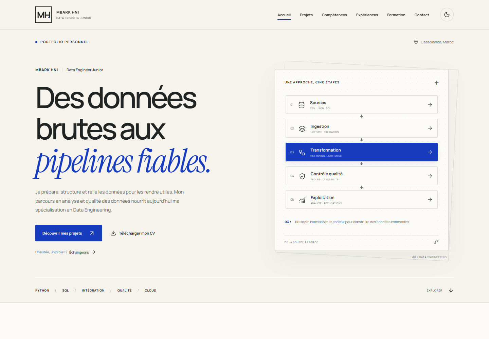

# Mbark HNI — Portfolio

Portfolio en français de **Mbark HNI, Data Engineer Junior à Casablanca**.
React, TypeScript, Vite et CSS. Hébergement statique sur GitHub Pages ; aucun backend.



## Démarrer

Prérequis : Node.js 22.12+ ou 24 LTS, npm.

```bash
npm ci
npm run dev
```

Ouvrir l’adresse indiquée par Vite, généralement **http://localhost:5173/portfolio/**.

Dans ce poste WSL :
```bash
cd /home/mbrak/portfolio
npm run dev
```

## Vérifier et construire

```bash
npm run check
npm run build
npm run preview
```

Le build vérifie TypeScript, puis génère `dist/`. La prévisualisation du build est
généralement disponible sur **http://localhost:4173/portfolio/**.
Les polices sont embarquées localement ; aucune requête Google Fonts à la visite.

## Organisation

- `src/data/portfolio.ts` : profil, liens, projets, compétences, parcours, formations, certifications et textes d’interface français.
- `src/components/Navigation.tsx` : navigation mobile, repérage de section et thème persistant.
- `src/components/Visuals.tsx` : illustrations de pipelines et étape interactive de l’accueil.
- `src/components/Projects.tsx` : cartes et études de cas dans un dialogue natif accessible.
- `src/App.tsx` : composition des sections et contact.
- `src/styles.css` : styles, thèmes et adaptations responsive.
- `src/lib.ts` : résolution des ressources à partir du chemin de base.
- `public/cv/mbark-hni.pdf` : CV fourni, conservé sans modification.
- `public/og-cover.png` : aperçu de partage 1200 × 630.
- `.github/workflows/deploy.yml` : publication manuelle sur GitHub Pages.
- `docs/CONTENU-A-CONFIRMER.md` : informations à compléter.
- `.qa/` : captures et scripts de contrôle locaux, exclus de Git.

## Personnaliser

Modifier `profile` et les tableaux dans `src/data/portfolio.ts`.
Le lien LinkedIn reste masqué si `profile.linkedin` est vide.

Pour ajouter un projet, ajouter un objet conforme au type `Project` :
titre, contexte, données, démarche, technologies, livrables, attribution,
limites et architecture. Ne renseigner que des informations vérifiables.
`repositoryAvailable: false` masque le lien de code indisponible.

Des médias facultatifs peuvent être fournis dans `image`, `imageAlt` et `demo`.
Placer les captures dans `public/images/` et utiliser un chemin comme
`images/mon-projet.webp`. Les images absentes sont remplacées par les
illustrations ; les liens de démonstration vides restent masqués.

Les textes d’interface sont regroupés dans `messages.fr` et les contenus
dans les collections typées. Pour ajouter l’anglais, créer les traductions
équivalentes et sélectionner explicitement la locale. Le site livré ne
présente pas de bouton de langue sans traduction.

Les couleurs sont dans les variables `:root` et `[data-theme="dark"]`.
Le thème suit le système lors de la première visite, puis conserve le choix
manuel dans `localStorage`. Les animations respectent `prefers-reduced-motion`.

## Publier sur GitHub Pages

**Aucune publication n’a été effectuée.** Le workflow se déclenche uniquement
sur demande manuelle ; pousser le code ne met pas le site en ligne.

1. Créer un dépôt GitHub nommé `portfolio` sur le compte `HNIMBARK`.
2. Envoyer les fichiers de ce dossier, y compris `package-lock.json` et `.github/`.
   Ne pas envoyer `node_modules/`, `dist/` ni `.qa/`.
3. Dans **Settings → Pages → Build and deployment**, choisir **GitHub Actions**.
4. Dans **Actions → Publier le portfolio sur GitHub Pages**, cliquer sur
   **Run workflow** lorsque la publication est souhaitée.

L’adresse prévue est **https://hnimbark.github.io/portfolio/**.

Attention à l’environnement local : le dossier parent `/home/mbrak` possède
déjà un dépôt Git. Travailler dans un dépôt dédié au portfolio avant de faire
un commit ; ne pas ajouter le dossier personnel entier.

### Autre nom de dépôt ou domaine

Pour `HNIMBARK.github.io` ou un domaine à la racine, remplacer
`base: '/portfolio/'` par `base: '/'` dans `vite.config.ts`.
Pour un autre nom de dépôt, utiliser `base: '/nom-du-depot/'`.

Mettre aussi à jour :
- Les URL canonical, Open Graph et image de partage dans `index.html`.
- Les URL dans `public/robots.txt` et `public/sitemap.xml`.

Les ressources locales passent par `import.meta.env.BASE_URL` ou `%BASE_URL%`.
La navigation par ancres et les dialogues fonctionnent sans réécriture serveur.

Documentation officielle : https://vite.dev/guide/static-deploy.html#github-pages

## Contenus et attribution

- Sales Pipeline : projet pédagogique basé sur le support DataScientist.fr,
  https://github.com/DataScientist-fr/sales-pipeline.
- Randoneo : prototype présenté dans le dépôt personnel
  https://github.com/HNIMBARK/randoneo_assistant.
- Reconnaissance de signes arabes : fiche courte limitée aux informations
  fournies. Le dépôt retournait 404 lors de la vérification.
- Les intitulés historiques des postes sont conservés ; le titre de
  présentation actuel est Data Engineer Junior.
- Aucun résultat chiffré, niveau de maîtrise ou usage cloud en production
  non vérifié n’est annoncé.

Le CV téléchargeable conserve **Marrakech** comme localisation, tandis que
le site affiche **Casablanca** à la demande du propriétaire. Le titre de
positionnement du site n’a pas été ajouté au PDF. Actualiser le CV avant
publication si l’on souhaite aligner ces informations.

Les schémas sont des illustrations d’architecture, pas des interfaces de
production en temps réel. Les applications Python sont présentées par leurs
fiches ; elles ne sont pas exécutées sur GitHub Pages.

## Contrôles à reproduire

- Build TypeScript / Vite.
- Formats 1440, 1024, 768, 390 et 320 px : pas de débordement horizontal.
- Navigation clavier, lien d’évitement, menu mobile et fermeture avec Échap.
- Dialogues de projets : focus, fermeture et retour au bouton d’ouverture.
- Thème clair / sombre et persistance après rechargement.
- Copie de l’email, liens externes, ancres et téléchargement réel du PDF.
- Absence d’erreurs console et de ressources manquantes.
